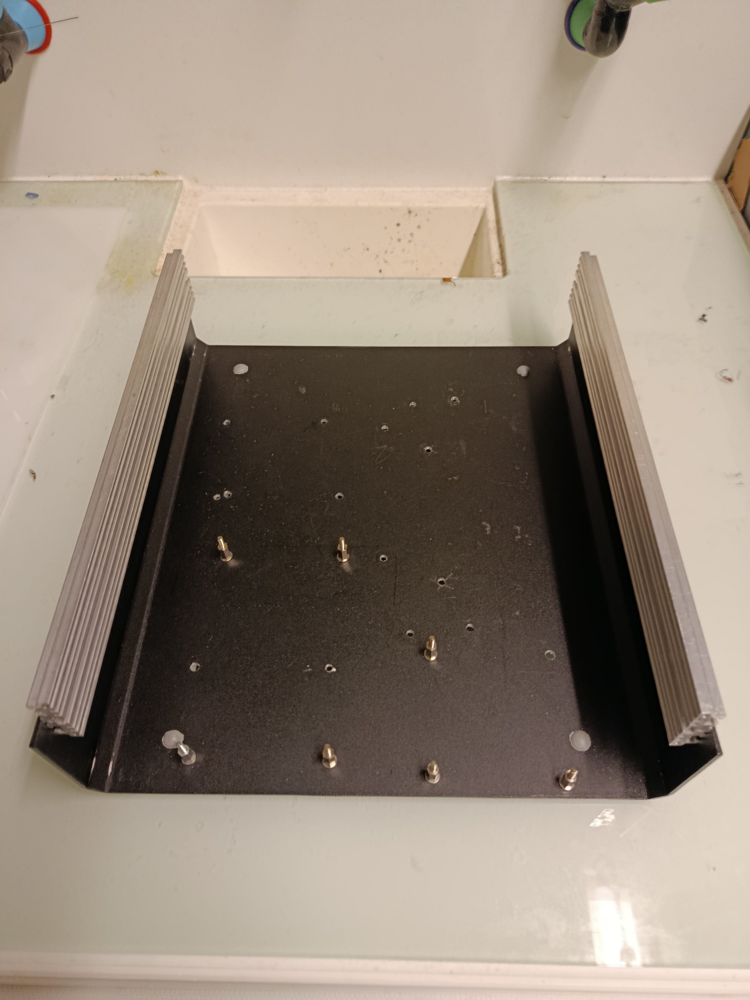
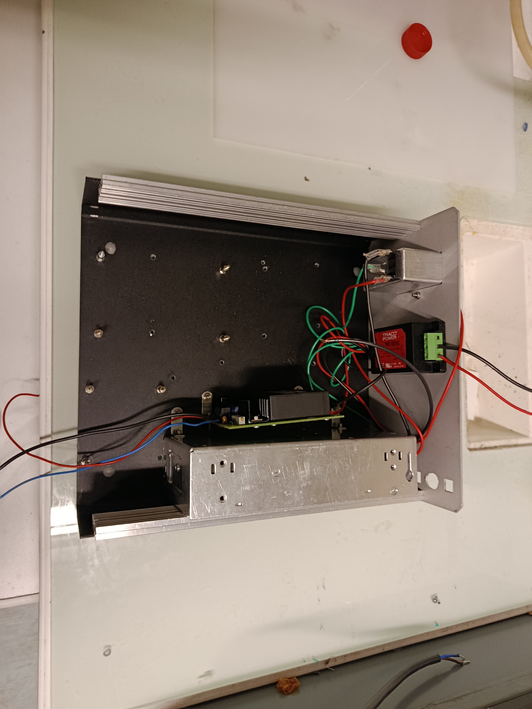
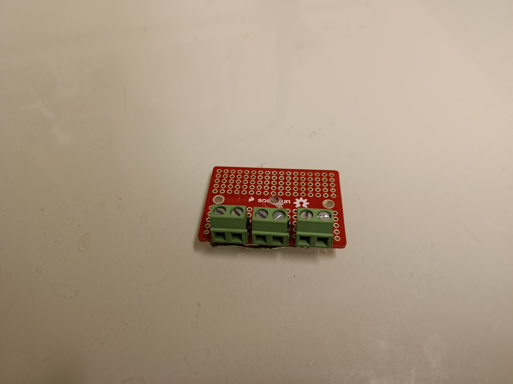
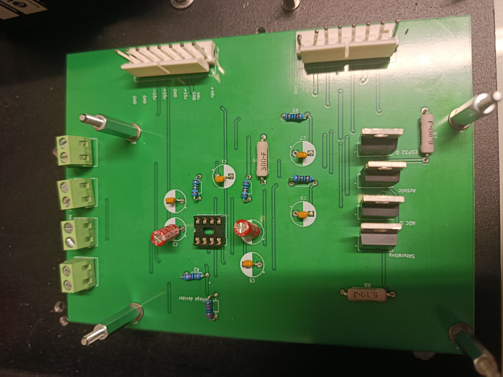
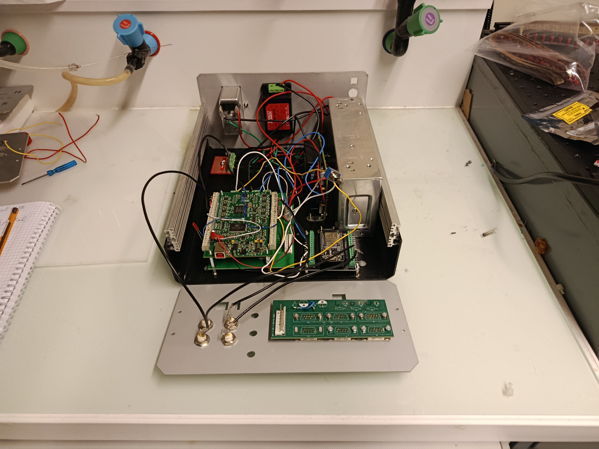
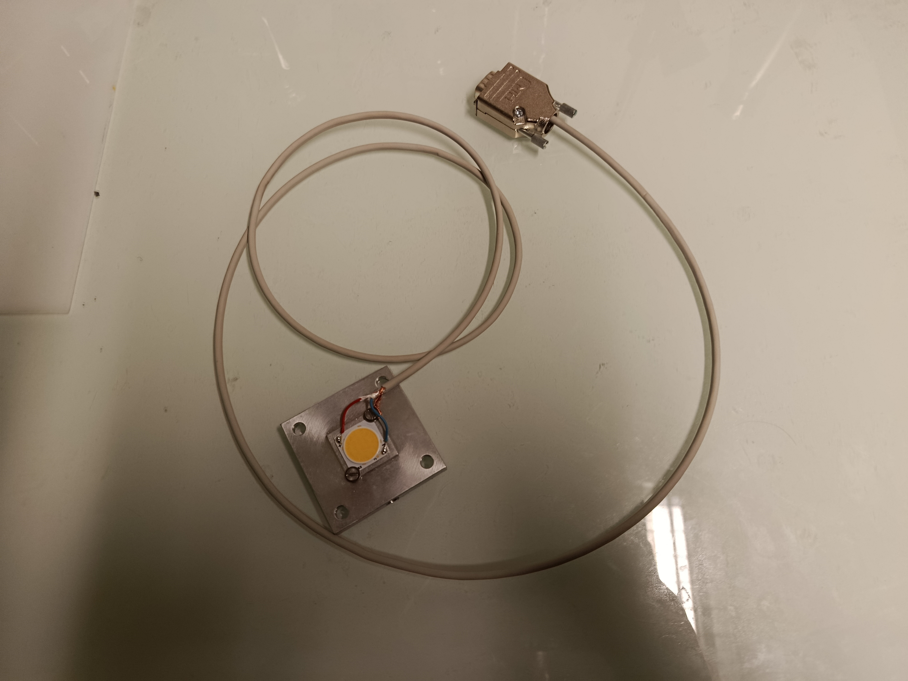

# Full build manual

This presents the full step-by-step instructions to build an OpenJTS. You will first need to order the materials indicated in the [Bill of Materials](bom.md).

Before you start:

- Read through the [Technical notes](../technical-notes/index.md) for the module you are working on. They explain *why* each part is built the way it is, which makes it much easier to spot a mistake during assembly.
- Gather the tools listed at the bottom of the [BOM](bom.md): soldering iron, screwdrivers and spanners, pliers, and a small drill.
- Work on the electronics (preamp PCBs, LED controller, front panel PCB) on an ESD-safe surface. The AD797 and JFET op-amps used in the preamps are sensitive to static discharge.
- The instrument is connected to mains power and uses a 48 V rail to reverse-bias the photodiodes and drive the detection LEDs. Unplug the instrument from the mains before touching exposed connections.

*Add photo here*

---

## Building the structure

There are two options for the mechanical structure.

### Option 1: optical construction rails

The structure is built from 25 mm square optical construction rails (Thorlabs XE25 series), joined with construction cubes and elbow plates, and finished with drop-in T-nuts and low-profile channel screws. This rail frame carries the two preamp cases and the LED housings.

1. Cut or order the rails to the lengths required for your layout.
2. Assemble the frame using the construction cubes (corners) and elbow plates (right-angle joints).

### Option 2: CNC-machined structure

**TODO:** add instructions.

*Add photo here*

---

## Installing the power supplies and PCB supports

Three supplies are used:

| Supply | Used for |
|---|---|
| 15 V linear | ±15 V analog rails for the preamp op-amps and the actinic VCCS (see [VCCS Design](../technical-notes/VCCS-design.md)) |
| 15 V switching | Power for the actinic LED |
| 48 V switching | Photodiode reverse bias and detection LED driver (see [LED control §1.2](../technical-notes/LED-control.md#12-intensity)) |

1. Drill the holes for the supplies and for the PCB standoffs, making sure the PCBs will line up with the front panel.
2. Mount the power line filter on the back panel, with the L, N, and Earth wires already soldered.
3. Connect the L, N, and Earth wires to the inputs of the 15 V linear, 15 V switching, and 48 V switching supplies.
4. Fit brackets to the 15 V linear and 48 V switching supplies, then screw them into the corresponding holes.
5. Glue the 15 V switching supply to the back panel.

Note: you are free to arrange the power supplies differently.

 
 

---

## Building the case PCBs

### Common ground circuit

1. Fit connectors (green screw terminals) onto a copper plate.
2. Mount the plate in the case on a standoff. It serves as the 0 V reference for all circuits, the ADC, and the ESP32.

### LED controller

The **LED controller PCB** is the VCCS (voltage-controlled current source) and MOSFET board that drives the actinic and detection LEDs from an analog or digital output (ADC or ESP32). See [VCCS Design](../technical-notes/VCCS-design.md) for the full circuit.

1. Build the LED controller according to the schematic, or order an SMD version with all components already soldered.
2. Mount the LED controller on its standoffs.

### Front panel circuit

1. Build the front panel circuit.
2. Leave the front panel open until the internal wiring is complete.

### ESP32 and ADC

The ESP32 is a secondary controller used for one-shot commands and standalone sequencing, including laser triggering, which the ADC path cannot do (see [Waveform Generation §2](../technical-notes/waveform-generation.md#2-esp32-many-digital-pins-two-8-bit-dacs)). Pin assignments are documented in [Firmware](../../firmware/firmware.md).

The **ADC** is the MCC USB-1808X DAQ board, which generates the actinic/detection waveforms and digitises the preamp outputs. See [Waveform Generation](../technical-notes/waveform-generation.md) for how its output channels are used.

1. Seat the ESP32 on its shield and mount the assembly on its standoffs.
2. Mount the MCC USB-1808X in the instrument case, or externally in its enclosure.
3. Connect the USB ports of the ESP32 and the ADC to the host PC, or to an internal hub if the instrument exposes a single external USB port.

*Add photo here*

---

## Building the switches and BNC connections

1. Wire the ADC analog inputs according to the following table:

   **TODO:** add table.

2. Build the ESP32/ADC switch and connect it according to the following diagram:

   **TODO:** add diagram.

3. Build the Fluo/Spectro switch and connect it according to the following diagram:

   **TODO:** add diagram.

4. Build the BNC inputs and connect them through the front panel: **TODO:** list the BNC inputs.
5. Connect the trigger and the clock, using a 1 nF capacitor to filter the pulses.
6. Connect the laser A and laser B BNC connectors.

*Add photo here*

---

## Wiring power between the PCBs

Power distribution inside the instrument case uses Molex KK 396 8-way connectors (male header + female housing) with crimp terminals.

1. Connect the power supplies to the LED control PCB.
2. Build the 8-pin crimped cables:
   1. Strip a few millimetres of insulation from each wire.
   2. Crimp a terminal onto each wire and check the connection with a light tug test.
   3. Insert each terminal into its position in the housing until it clicks into place, using a consistent pin-out across every cable.
3. Connect the cables to the different PCBs.
4. Close the front panel.

*Add photo here*

---

## Building the LED cases

The instrument uses two independent light paths: the **detection** LEDs (short, stable flashes used to probe the sample) and the **actinic** LED (the light that drives the physiological change being observed). See [Technical choices: LED control](../technical-notes/LED-control.md) for why each was designed the way it was.

1. Build the detection LED module using twisted-pair cable. Beware of the positive and negative sides, and remember to connect the case to ground.

   

2. Build the actinic LED disc, as specified in [LED control](../technical-notes/LED-control.md), using an SMD reflow oven.
3. Place the disc on the module.
4. Glue the diffuser to the module.
5. Solder the cable ends to a Sub-D9 connector, checking that each wire goes to the correct pin.
6. Assemble the 3 parts and screw them together.
7. Insert the long M6 screw in the appropriate hole, screw it to the Thorlabs T-nut, and place the case on the structure.

*Add photo here*

---

## Building the photodiode cases

Each detection channel (measurement and reference) has its own photodiode case, so this section is carried out **twice**. The case houses the transimpedance amplifier (TIA) that turns the photodiode's photocurrent into a voltage. See [Transimpedance Amplifier Design](../technical-notes/preamp-design.md) for the rationale behind the component choices.

1. Build the preamp PCB, or order it fully assembled in SMD.

   Note: a fully assembled PCB will be more expensive and harder to repair if a component fails.

2. Solder the BNC and the right-angle Sub-D9 connector to the preamp PCB.
3. Solder the photodiode, keeping the wires as short as possible to minimise parasitic capacitance.
4. Assemble the case.
5. Insert the long M6 screw in the appropriate hole, screw it to the Thorlabs T-nut, and place the case on the structure.

*Add photo here*

---

## Connecting everything

**TODO:** check this table against the final wiring.

| From | To | Notes |
|---|---|---|
| Preamp PCB output (×2) | ADC analog input (BNC) | Measurement and reference channels |
| ADC AO0 | LED controller (VCCS) input | Actinic level, see [Waveform generation §1.4](../technical-notes/waveform-generation.md#14-channel-0--actinic-light) |
| LED controller output | Actinic LED PCB | See [VCCS design](../technical-notes/VCCS-design.md) |
| ADC AO1 | Detection LED driver | Detection flash amplitude, see [Waveform generation §1.5](../technical-notes/waveform-generation.md#15-channel-1--detection-flash) |
| ADC digital port | Acquisition trigger | See [Waveform generation §1.6](../technical-notes/waveform-generation.md#16-channel-2--the-trigger) |
| ESP32 `actinicDacPin` (GPIO26) | Actinic driver (standalone/manual mode) | See [Firmware](../../firmware/firmware.md#hardware-pins) |
| ESP32 `detectorDacPin` (GPIO25) | Detection LED driver (standalone/manual mode) | Digital on/off only |
| ESP32 `TriggPin` (GPIO12) | External DAQ trigger (optional) | |
| ESP32 `laserChannel_open` / `laserChannel_start` (GPIO18/19) | External laser controller (optional) | Only available on the ESP32 path |

1. Check the rail voltages at each board's power input before connecting any signal cable.
2. Connect all the LEDs, the BNC cables, and the preamp/photodiode power cables, labelling both ends of each cable.
3. Power on the instrument and confirm, with the host software, that both detection channels read a stable baseline and that the LEDs respond to test commands.
4. Calibrate the actinic intensity.
5. Calibrate the trigger timing.
6. Check the shape of the response on an oscilloscope.

*Add photo here*