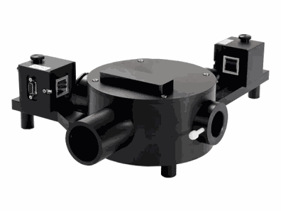

# OpenJTS: an open-source Joliot-type LED pump-probe spectrophotometer for photosynthesis research

*Hardware metapaper for submission to the Journal of Open Hardware.*

> **Drafting notes (remove before submission).** Items marked **TODO** need information that is not
> yet in the repository documentation, mostly measured data, author details, and archive
> identifiers. References marked *(verify)* were added from general knowledge and must be checked
> against the original sources before submission.

---

# (1) Overview

## Title

OpenJTS: an open-source Joliot-type LED pump-probe spectrophotometer for photosynthesis research

## Authors

1. Larran, Christopher; (lead/corresponding author)
2. **TODO:** additional authors

<!-- affiliations -->

1. **TODO:** first author affiliation
2. **TODO:** second author affiliation

## Abstract

Joliot-type spectrophotometers (JTS) measure small, light-induced absorbance and fluorescence changes in photosynthetic samples with microsecond time resolution. They are widely used to follow the electrochromic shift (ECS) and the operating efficiency of photosystem II (Φ<sub>PSII</sub>). Commercial instruments are costly, closed, and hard to repair or modify, so few laboratories can own or adapt one. OpenJTS is an open-hardware JTS that a laboratory with modest electronics skills can build for about €2,540 in parts. The instrument flashes 20 µs detection pulses from white SunLike COB LEDs through interchangeable round filters and drives a red actinic LED array through a voltage-controlled current source (VCCS). Two independent detection LEDs and two reverse-biased silicon photodiodes, each with its own transimpedance preamplifier, form a measurement channel and a reference channel. An MCC USB-1808X DAQ generates the actinic, detection, and trigger waveforms from a single 500 kHz clock, so light and sampling stay aligned to within 2 µs. It also digitises the preamplifier outputs. An ESP32 microcontroller provides a second, standalone sequencing path with laser triggering. Compared with earlier JTS designs, OpenJTS replaces the Y-shaped fibre with two independent detection LEDs, offers 16-bit control of actinic and detection intensity, supports arbitrary actinic waveforms such as sine modulation, and is optimised for flat samples. A Python desktop application (DearPyGui) runs pulse sequences written in a compact domain-specific language, as well as frequency-modulated protocols, and averages, baseline-corrects, and exports the results. All PCB designs, firmware, software, and documentation are released under the Apache 2.0 licence.

<!-- Word count: ~245 -->

---

> ### Metadata Overview
>
> **Main design files:** https://github.com/ILikeNickelback/OpenJTS (KiCad PCB designs in `hardware/KiCAD/`, firmware in `firmware/`, software in `software/`, build manual and BOM in `docs/hardware/build/`)
>
> **Target group:** scientists in photosynthesis research and plant/algal physiology; laboratory technicians and trained engineers supporting biophysics laboratories
>
> **Skills required:** through-hole and basic SMD soldering (easy to advanced, or use a PCB assembly service); SMD reflow soldering of the actinic LED disc (advanced); crimping and panel wiring at mains voltage (advanced); CNC-machined aluminium parts (professional service); mechanical assembly on optical construction rails (easy); installing and running the Python software (easy); flashing the ESP32 firmware with PlatformIO (easy)
>
> **Replication:** **TODO:** state whether the instrument has been replicated outside the authors' laboratory and give a contact. Future builds and issues are tracked on the GitHub repository.
>
> *See section "Build Details" for more detail.*
>
> ### Keywords
>
> photosynthesis; pump-probe spectroscopy; chlorophyll fluorescence; electrochromic shift; open hardware

---

## Introduction

Light-induced absorbance changes in photosynthetic membranes are among the most informative signals in photosynthesis research. They report the transmembrane electric field through the electrochromic shift (ECS) of carotenoids and chlorophylls, the redox state of cytochromes and P700, and, together with chlorophyll fluorescence, the efficiency of photosystem II [1–3]. These signals are small (relative absorbance changes of 10<sup>−3</sup> to 10<sup>−5</sup>) and evolve on time scales from microseconds to seconds. Measuring them therefore requires a probe light that is too short and too weak to drive photosynthesis itself, a separately controlled actinic light that does, and a detector that resolves microsecond flashes with a high signal-to-noise ratio.

The Joliot-type spectrophotometer (JTS) solves this with a pump-probe approach [1]. Short non-actinic detection flashes are fired at chosen times during an actinic light protocol. A photodiode measures the transmitted (or emitted) light of each flash, and comparing the flashes gives the light-induced change. Early JTS designs used xenon flash lamps. Because these vary strongly from flash to flash, the same flash was split between a measurement channel and a reference channel with a beam splitter or a Y-shaped fibre, and each measurement was normalised as (I<sub>meas</sub> − I<sub>ref</sub>) / I<sub>ref</sub>.

Commercial descendants of this design, such as the JTS series from Bio-Logic/JBeamBio [4], are mature but expensive and closed. Users cannot easily repair, adapt, or inspect them, which matters for a technique whose results depend on the timing and spectral details of the light. OpenJTS is an open alternative intended to be built in-house by laboratories with modest skills and budget. Compared with earlier designs, it:

- replaces the xenon source and Y-fibre with **two independent, stable LED detection channels** driven by a common circuit, removing the costly fibre optic component;
- provides **continuous, high-resolution control** of actinic and detection intensity (16-bit analogue output) instead of a small set of resistor-selected levels;
- supports **arbitrary actinic waveforms**, including sine modulation for frequency-domain protocols, because actinic light is generated by a true analogue output and a VCCS rather than PWM;
- has a **new Python user interface** with a plain-text sequence language, multiple simultaneous experiments, averaging, baseline subtraction, and workspace save/restore;
- uses a mechanical layout **optimised for flat samples** such as leaves and algal films.

**TODO:** describe the research for which OpenJTS has been used so far and cite any resulting publications.

## Overall Implementation and design



**TODO:** replace with a photograph of the assembled OpenJTS and add a block diagram (light sources → sample → photodiodes → preamps → DAQ ← host PC → ESP32).

OpenJTS consists of four physical sub-assemblies connected by shielded cables:

1. **Instrument case** (RS 769-4914 enclosure) containing the power supplies (15 V linear, 15 V switching, 48 V switching), a common ground plate, the LED controller PCB, the ESP32 on a carrier board, the front panel PCB with BNC connectors and mode switches, and optionally the MCC USB-1808X DAQ.
2. **Detection LED housings** (two), CNC-machined aluminium, each holding a SunLike white COB LED, a 25 mm colour filter, and a diffuser.
3. **Actinic LED housing**, holding a custom aluminium-core PCB with eight Cree XLamp XE-G red LEDs behind a diffuser.
4. **Photodiode cases** (two, measurement and reference), CNC-machined aluminium, each holding a Hamamatsu Si PIN photodiode and its transimpedance preamplifier PCB.

The optical heads are mounted on a frame of 25 mm Thorlabs XE25 construction rails using M6 screws and drop-in T-nuts. A CNC-machined frame is planned as an alternative (see Future Work). A host PC running Windows 10/11 controls the DAQ and the ESP32 over USB.

### Detection light path

The detection LEDs must deliver clean, stable, and powerful 20 µs pulses. Instead of one LED per colour, OpenJTS uses a broadband white SunLike COB LED with a flat visible spectrum (400–800 nm) and selects the wavelength with inexpensive 25 mm round filters (e.g. 480 nm, 520 nm, 720 nm). Only one driver output is therefore needed per LED, and the colour can be changed by swapping a filter. The trade-off is some residual out-of-band light, which the filter set must suppress.

Each LED is driven from a 48 V switching supply (the LED needs at least 38 V) through a two-stage supply filter, an IRF540N MOSFET, and a 50 Ω shunt resistor, chosen empirically as the best compromise between pulse power and stability. A 100 Ω gate resistor limits ringing. Because the detection LEDs are now stable, the two channels no longer share one source. The reference channel no longer cancels fast flash-to-flash noise; instead, it corrects slow shared drift such as temperature and LED ageing (see Calibration).

### Actinic light path and VCCS

The actinic light runs from milliseconds to seconds, its intensity must be programmable within a sequence, and it must support amplitude modulation. OpenJTS drives the actinic LED array with a VCCS. An AD797 op-amp compares the control voltage with the voltage across a 30 Ω sense resistor and drives an IRF540N MOSFET so that I<sub>out</sub> = V<sub>in</sub> / R<sub>sense</sub>. Because LED output is linear in current, not voltage, this gives a predictable intensity response. A resistive divider (about 1:5) scales the 0–10 V DAQ output into the range the supply headroom allows. A small gate–source capacitor suppresses high-frequency oscillation of the MOSFET that was observed as noise on the photodiode signal. PWM was deliberately avoided because a switched light is not continuous, which complicates interpretation in biological experiments.

### Photodetection and transimpedance preamplifier

Each channel uses a large-area Hamamatsu Si PIN photodiode (S3204-08) reverse-biased at 48 V. This lowers its terminal capacitance to about 47 pF while keeping the dark current at a few nA. The preamplifier must resolve a 20 µs pulse without excessive edge rounding: a rise time of about 1/17 of the pulse width (≈1.2 µs) gives a minimum closed-loop bandwidth of ≈300 kHz. The highest expected photocurrent (≈50 µA) and the DAQ's ±10 V input range fix the total transimpedance at 200 kΩ.

Two architectures were evaluated: a single-stage JFET TIA (ADA4622-1 or ADA4637-1 class, ±15 V) and a two-stage design with a fast low-noise JFET front-end on regulated ±5 V rails followed by an AD797 voltage-gain stage on ±15 V. **TODO:** state which architecture the final preamp PCB uses and give the final component values. A single-pole RC anti-aliasing filter (f<sub>c</sub> ≈ 0.5–1 MHz) follows the amplifier. No input clamp diodes are needed because the DAQ inputs tolerate ±25 V. The layout keeps the summing node short, voids the ground plane under the input, adds a guard ring, and isolates the 48 V bias line.

### Waveform generation and acquisition: two complementary paths

OpenJTS can generate its light protocols in two ways, selected by a configuration flag.

**DAQ path (default for timing-critical work).** The MCC USB-1808X streams one interleaved 16-bit buffer to three outputs at 500 kHz: AO0 (actinic level), AO1 (detection flash amplitude), and a digital port (acquisition trigger). Because all three channels come from the same buffer and clock, the trigger, the flash, and the actinic level are aligned to within one 2 µs sample. Each flash is 10 samples (20 µs). The trigger channel writes a short pre-flash marker to sample the baseline and a second marker 6 µs into the flash, just before it ends. Each trigger re-arms a retriggered input scan, so the 8-channel analogue input captures a fixed block of samples per flash. Actinic waveforms can be steps (sequence mode) or sine waves sampled at the full 500 kHz rate (frequency mode).

**ESP32 path.** An ESP32 running a non-blocking state machine (Arduino framework, PlatformIO) receives framed text commands over USB serial. It can set a constant actinic level through its 8-bit DAC, fire detection flashes as 18 µs digital pulses bracketed by trigger pulses for the DAQ, and play an entire sequence on its own. It also has two laser-trigger outputs (open/start handshake), which the three-channel DAQ path has no spare channel for. Direct GPIO register writes and maximum pad drive strength keep edges sharp at microsecond scales. A front-panel switch selects which path drives the LEDs.

| | DAQ path | ESP32 path |
|---|---|---|
| Output channels | 2 analogue + 1 digital | Many GPIO, one 8-bit DAC used |
| Resolution | 16 bit | 8 bit |
| Timing | single 500 kHz clock, sample-accurate | timed in firmware |
| Detection flash | analogue, adjustable amplitude | digital on/off |
| Actinic waveform | arbitrary (step, sine) | steps only |
| Laser trigger | not available | two dedicated outputs |

### Measurement strategy

For each flash, a point sampled just before the flash is subtracted from the point sampled during it, which removes the DC component from ambient light and bias. In spectroscopy mode, the signal is ΔI/I = (I<sub>meas</sub> − I<sub>ref</sub>) / I<sub>ref</sub>. In fluorescence mode, the signal is larger and a single channel is used. Optionally, the measurement and reference signals can each be wired to four DAQ inputs and averaged, which reduces uncorrelated ADC noise by about √4 = 2.

### Control software and sequence language

The desktop application (Python 3.14, DearPyGui, mcculw, NumPy, pyserial, loguru) is event-driven. A shared application state and a publish/subscribe event bus connect the windows, and separate threads handle the GUI, acquisition control, ADC reading, and statistical processing. Users can open several Fluo or Spectro experiments at once, each in its own tab. Protocols are written in a compact text language. For example, the ECS protocol

```
4(100msD) A[100] 50ms A[0] 300µsD 1msD 2msD 5(5msD) 5(10msD) 5(20msD) 5(50msD) 5(100msD)
```

means four detection flashes 100 ms apart, 50 ms of full actinic light, then detection flashes at increasing intervals. The software expands repeats, previews the timing, discards warm-up runs, averages repeated runs, subtracts a baseline, plots results live, autosaves after each acquisition, and exports samples and full workspaces to JSON. A library of standard protocols (ECS, Φ<sub>PSII</sub>) is included.

### Variants

- **Structure:** Thorlabs XE25 optical rails (documented) or a dedicated CNC-machined frame (planned).
- **PCBs:** hand-soldered through-hole/SMD boards, or boards ordered fully assembled from a PCB service (more expensive and harder to repair).
- **DAQ placement:** inside the instrument case or external in its own enclosure.
- **Actinic colour:** the current build provides red only. An earlier version used a combined blue/red/far-red chip with one cable per colour.

---

# (2) Quality control

## Safety

- **Mains voltage.** The instrument is mains powered through a filtered IEC inlet with L, N, and protective earth wired to three internal supplies. Wiring must be done with the instrument unplugged, the case and LED housings must be bonded to earth, and the instrument must not be opened while plugged in.
- **48 V rail.** The photodiode bias and the detection LED driver use 48 V DC. This is close to the SELV limit and can deliver high peak currents. Users should not touch exposed connections while the instrument is powered.
- **Electrostatic discharge.** The AD797 and JFET op-amps in the preamplifiers are ESD sensitive and should be handled on an ESD-safe surface.
- **Optical.** The actinic array (eight high-power red LEDs) and the detection COB LEDs are bright enough to cause glare and discomfort. Users should not look directly into the LED heads while they are on.
- **Thermal.** The VCCS MOSFET and the actinic LED disc dissipate significant power during long actinic pulses and should be heat-sunk to the aluminium housing.

**TODO:** reference a formal risk assessment if one exists.

## Calibration

The quantity OpenJTS reports is a *relative* change (ΔI/I, or fluorescence yield ratios such as Φ<sub>PSII</sub>). The measurement therefore depends on linearity and timing rather than on an absolute photometric scale. The design and software include the following procedures:

- **Detection flash timing.** In the DAQ path, the flash and the sampling trigger share one 500 kHz clock, so their alignment is fixed by construction (±2 µs). The sampling point is placed 2–3 µs before the end of the 20 µs flash so that the preamplifier has settled. **TODO:** add an oscilloscope trace of the preamp output with the trigger position overlaid, and report the measured rise time.
- **DC subtraction.** Each point is corrected with a pre-flash sample, which removes ambient light and slow offsets that are stable over a few microseconds.
- **Reference channel drift correction.** The reference photodiode tracks slow changes in detection LED output, such as warm-up and temperature drift, and the ratio (I<sub>meas</sub> − I<sub>ref</sub>) / I<sub>ref</sub> cancels them.
- **Detection LED setup.** A built-in 1 Hz continuous-flash mode lets the user adjust detection intensity and balance the two channels before a measurement, using the live plot.
- **Actinic intensity.** The VCCS gives a current proportional to the control voltage. LED and driver non-linearities are compensated with per-LED offsets in `config.json`. **TODO:** calibrate actinic photon flux density (µmol photons m<sup>−2</sup> s<sup>−1</sup>) at the sample plane against a calibrated quantum sensor, and report the resulting intensity-vs-setting curve with its dataset.

To relate OpenJTS data to other instruments, users can run the bundled ECS and Φ<sub>PSII</sub> protocols on a reference sample and compare them with a commercial JTS or PAM fluorometer. **TODO:** report such a comparison.

## General testing

The following design targets come from the technical notes. **TODO:** add measured values and datasets for each.

| Characteristic | Design target | Measured |
|---|---|---|
| Detection pulse width | 20 µs | **TODO** |
| Preamplifier closed-loop bandwidth | ≥ 300 kHz | **TODO** |
| Light/trigger alignment (DAQ path) | ≤ 2 µs (one sample) | **TODO** |
| DAQ output / input resolution | 16 bit / 16 bit, ±10 V | n/a (manufacturer spec) |
| Maximum photocurrent before saturation | ≈ 50 µA at 200 kΩ | **TODO** |
| Shortest detection interval in a sequence | **TODO** | **TODO** |
| Baseline noise of ΔI/I (single flash, averaged N flashes) | **TODO** | **TODO** |
| Flash-to-flash detection LED stability | **TODO** | **TODO** |

Software quality is checked automatically. On every push and pull request, a GitHub Actions workflow on Windows lints the code with ruff and runs unit and integration tests with pytest. These cover the sequence decoder, waveform builder, data processing, workspace management, ESP32 port discovery, and the worker–hardware boundary, using a fake DAQ. System tests with real hardware are run by hand as a bench checklist. The firmware is not yet covered by automated tests.

---

# (3) Application

## Use case(s)

**TODO:** this section requires experimental results, which are not yet in the documentation. Suggested content:

### Electrochromic shift (ECS) kinetics

Run the bundled ECS protocol (four dark flashes, a 50 ms saturating actinic pulse, then detection at increasing intervals) on a leaf or algal sample with a 520 nm detection filter in Spectro mode. Show the ΔI/I trace, its fast rise and slow decay, and the effect of averaging on noise. Ideally compare it with the same sample on a commercial JTS.

### Φ<sub>PSII</sub> measurement

Run the bundled Φ<sub>PSII</sub> protocol in Fluo mode with a 480 nm detection filter. Report F<sub>0</sub>, F<sub>m</sub>, and F<sub>s</sub>/F<sub>m</sub>′ and the derived Φ<sub>PSII</sub> = (F<sub>m</sub>′ − F<sub>s</sub>) / F<sub>m</sub>′ [3] for dark-adapted and light-adapted samples.

### Frequency-modulated actinic light

Show a sinusoidally modulated actinic protocol (frequency mode) and the resulting oscillating ECS or fluorescence response. Commercial instruments based on discrete intensity steps cannot easily reproduce this.

For each use case, deposit the exported JSON data files alongside the figures (e.g. on Zenodo) and link them here.

---

# (4) Build Details

## Availability of materials and methods

All electronic components are standard catalogue parts, mostly from RS Components and DigiKey. The full bill of materials with supplier links is in `docs/hardware/build/bom.md`. Key items and their availability:

- **DAQ:** MCC USB-1808X (Digilent/Measurement Computing). At about €1,040, this is the most expensive part and comes from a single manufacturer. Its driver library, mcculw, is Windows-only. Another simultaneous-sampling DAQ with two analogue outputs and a clocked digital output could be substituted, but the hardware layer of the software would need to be rewritten.
- **Microcontroller:** ESP32 DevKit (`esp32dev`) on a carrier board. Widely available.
- **Semiconductors:** AD797 op-amps, IRF540N and IRLZ44N MOSFETs. Widely available.
- **Optoelectronics:** Hamamatsu S3204-08 Si PIN photodiodes (single manufacturer), Cree XLamp XE-G red LEDs, SunLike white COB LEDs, 25 mm round colour filters, and diffusers. **TODO:** complete prices and part numbers for the filters, diffusers, detection LEDs, and sample window in the BOM.
- **Power:** off-the-shelf 15 V linear, 15 V switching, and 48 V switching supplies, plus a mains filter.
- **PCBs:** preamp (×2), LED controller, actinic LED disc (aluminium core), and front panel, designed in KiCad and orderable from any PCB service (e.g. JLCPCB). Fabrication outputs (Gerbers, BOM, positions) are in `hardware/KiCAD/*/production/`.
- **Mechanics:** Thorlabs XE25 rails, cubes, elbow plates, and T-nuts, plus ten CNC-machined aluminium parts (LED, filter, diffuser, and photodiode holders, preamp cases, front panel, and sample holder) orderable from a CNC service (e.g. JLCCNC).

The total cost of the documented BOM is about **€2,540** (2026 prices, VAT and shipping excluded), of which about 40 % is the DAQ.

Assembly needs a soldering station, an SMD reflow oven (for the actinic LED disc, or outsource it), a crimping tool for Molex KK 396 terminals, screwdrivers and spanners, pliers, and a small drill.

## Ease of build / Design decision

Measures taken to make the instrument easier to build and maintain:

- **One broadband detection LED per channel with filters**, instead of an array of single-colour LEDs. This reduces the detection driver to a single MOSFET stage and makes changing colour a mechanical swap.
- **Two independent detection LEDs** instead of a beam splitter or Y-shaped fibre. This removes the most expensive and most delicate optical component and the associated alignment.
- **Analogue output + VCCS** instead of a resistor/transistor matrix. Thousands of intensity levels come from one simple circuit and software, and the same circuit supports arbitrary waveforms.
- **Voltage divider at the VCCS input** instead of a higher-voltage supply. It is simple and can be re-scaled for any supply.
- **No input protection diodes**, because the DAQ tolerates ±25 V. This avoids parasitic capacitance at the ADC input.
- **Commercial optical construction rails** for the frame, so no custom machining is needed for the structure.
- **Standard connectors throughout** (BNC for signals, Sub-D9 for LED and preamp heads, keyed Molex KK 396 crimp cables for internal power), so sub-assemblies can be built and tested separately.
- **Option to order PCBs fully assembled**, at the cost of price and repairability.
- **Single-command software installation** with pixi and a locked environment, so the Python environment does not have to be set up by hand.

Design choices that were tried and changed, or did not work:

- **Xenon flash lamps and a shared reference flash** were abandoned because modern LEDs are stable and powerful enough.
- **PWM control of actinic light** was rejected because a switched light is not continuous.
- **Using the ESP32's DAC at code 0** left the actinic LED faintly lit because of the DAC's non-zero floor. The firmware now disables the DAC and drives the pin low for zero intensity.
- **Driving the VCCS directly with 0–10 V** saturated at a 3–4 V control signal because of limited headroom above the 38 V LED. A ≈1:5 input divider was added.
- **The VCCS MOSFET gate oscillated**, which appeared as high-frequency noise on the photodiode signal. A small gate–source capacitor fixed it.
- **Detection LED switching transients** (V = −L·dI/dt from stray inductance) perturbed the preamplifier output. The actinic and detection ground returns must be routed separately.
- **A gate driver for the detection MOSFET** has not been evaluated yet.

## Operating software and peripherals

- **Host PC:** Windows 10/11, 64-bit. The MCC driver (InstaCal / Universal Library) must be installed. A 1920×1200 display is recommended. The application maximises to this size with per-monitor DPI scaling.
- **Environment manager:** pixi, which resolves all dependencies from conda-forge using `pixi.toml` and `pixi.lock`.
- **Language and libraries:** Python 3.14, NumPy ≥ 2.4.6, DearPyGui, mcculw ≥ 1.0, pyserial ≥ 3.5, loguru ≥ 0.7.3, matplotlib ≥ 3.11. **TODO:** add DearPyGui to `pixi.toml`, which does not currently list it.
- **Firmware:** C++ (Arduino framework) for the ESP32 (`esp32dev`), built and flashed with PlatformIO (`espressif32` platform). It communicates at 115200 baud over USB serial.
- **Peripherals:** MCC USB-1808X and ESP32, each connected to the host by USB. An oscilloscope is recommended for commissioning.
- **Documentation:** Sphinx with MyST, built on Read the Docs, including auto-generated API documentation.

## Dependencies

- **MCC Universal Library and mcculw (Measurement Computing).** The DAQ driver is proprietary and closed source; the mcculw Python wrapper is open source. Both are Windows-only. This is the main reason the software is limited to Windows.
- **DearPyGui** (MIT), **NumPy** (BSD), **pyserial** (BSD), **loguru** (MIT), **matplotlib** (PSF-based): open source.
- **Arduino-ESP32 core and ESP-IDF** (Espressif, Apache 2.0 / LGPL): open source.
- **KiCad** (GPL): needed to edit the PCB designs. **TODO:** state the minimum KiCad version.
- **Thorlabs XE25 construction rail system:** commercial mechanical parts; a CNC alternative is planned.

## Hardware documentation / build instructions / files location

**Archive for hardware documentation and build files** (required)

**TODO:** once the article is accepted, deposit a tagged release of the repository on Zenodo and fill in the details below.

*Name:* OpenJTS **TODO** (e.g. "OpenJTS v1.0.0 – hardware design files and documentation")
*Persistent identifier:* **TODO** (Zenodo DOI)
*Publisher:* Christopher Larran
*Date published:* **TODO** (yyyy-mm-dd)

**Modifiable design files** (if different from above)

**TODO:** the KiCad PCB projects are in the repository, but the source CAD files (STEP) for the CNC-machined parts are not yet tracked. Add them to the repository, or deposit them here if they are kept separately.

*Name:* **TODO**
*Persistent identifier:* **TODO**
*Publisher:* Christopher Larran
*Date published:* **TODO**

**Software code repository** (required)

*Name:* GitHub – ILikeNickelback/OpenJTS
*Identifier:* https://github.com/ILikeNickelback/OpenJTS
*Date published:* 2026-06-11

Step-by-step build instructions: `docs/hardware/build/full-build-manual.md`, also published on Read the Docs (**TODO:** add the Read the Docs URL).

---

# (5) Discussion

## Conclusions

OpenJTS shows that a Joliot-type pump-probe spectrophotometer can be built from catalogue parts, three small custom PCBs, and a set of CNC-machined holders, for a fraction of the cost of a commercial instrument. The main lessons from the design iterations are:

- Modern LEDs are stable enough to replace xenon lamps and the fibre or beam-splitter optics built to compensate for them. The reference channel's role shifts from cancelling flash-to-flash noise to correcting slow drift.
- Generating all stimulus and trigger signals from one clocked multi-channel buffer is the simplest way to guarantee microsecond alignment between light and sampling.
- At microsecond time scales and amp-level pulse currents, layout and grounding (separate actinic and detection returns, gate damping, supply filtering) matter as much as component choice.

**TODO:** add a summary of measured performance and use-case results once Sections 2 and 3 are complete.

## Future Work

- **CNC-machined frame** as an alternative to the optical rail structure (instructions pending).
- **Laser triggering in the DAQ path**, which needs a fourth synchronised output or a hybrid DAQ/ESP32 scheme.
- **Adjustable detection intensity on the ESP32 path**, using its second DAC channel.
- **Multi-colour actinic light** (blue, red, far red), as in the earlier prototype.
- **Gate driver for the detection MOSFET**, to sharpen and stabilise the 20 µs pulse.
- **Post-processing tab** in the software (not yet implemented) and a use for the time-reference token `T` in the sequence language.
- **Hardware abstraction for other DAQs**, to remove the dependency on the proprietary, Windows-only MCC driver and allow Linux and macOS hosts.
- **Firmware tests** in continuous integration, and a documentation build check.
- **Known issues:** the ESP32 continuous-flash interval is fixed at 1 s regardless of the requested value. Sequence tokens sent to the ESP32 are concatenated without separators, so two adjacent numbers merge (users must put `A`, `D`, or `L` between numbers). The sequence decoder silently ignores unrecognised input.
- **Documentation gaps to close:** ADC input wiring table, switch wiring diagrams, BNC input list, final connection table, and assembly photographs.

## Paper author contributions (CRediT)

**TODO:** list each author's roles, for example:

- Christopher Larran: conceptualisation, hardware design, PCB design, firmware, software, documentation, writing – original draft.
- **TODO:** other authors and roles (supervision, validation, funding acquisition, writing – review & editing).

## Acknowledgments

**TODO:** acknowledge anyone who supported the project without working directly on the hardware, and list contributors to the hardware and software who are not authors, with their roles and affiliations.

## Funding statement

**TODO:** funder and grant number, or "This work received no specific funding."

## Competing interests

The authors declare that they have no competing interests. **TODO:** confirm.

## References

1. Joliot P, Béal D, Frilley B. Une nouvelle méthode spectrophotométrique destinée à l'étude des réactions photosynthétiques. *J Chim Phys.* 1980;77:209–216. *(verify)*
2. Bailleul B, Cardol P, Breyton C, Finazzi G. Electrochromism: a useful probe to study algal photosynthesis. *Photosynth Res.* 2010;106(1–2):179–189. DOI: https://doi.org/10.1007/s11120-010-9579-z *(verify)*
3. Genty B, Briantais JM, Baker NR. The relationship between the quantum yield of photosynthetic electron transport and quenching of chlorophyll fluorescence. *Biochim Biophys Acta.* 1989;990(1):87–92. DOI: https://doi.org/10.1016/S0304-4165(89)80016-9 *(verify)*
4. Bio-Logic / JBeamBio. JTS-150 pump-probe spectrophotometer [Internet]. **TODO:** URL and access date.
5. Hamamatsu Photonics. S3204-08 Si PIN photodiode datasheet [Internet]. Available from: https://www.hamamatsu.com/eu/en/product/optical-sensors/photodiodes/si-photodiodes/S3204-08.html
6. Measurement Computing / Digilent. MCC USB-1808X high-speed, high-precision simultaneous USB DAQ device [Internet]. Available from: https://digilent.com/shop/mcc-usb-1808x-high-speed-high-precision-simultaneous-usb-daq-device/
7. Analog Devices. How to design stable transimpedance amplifiers [Internet]. DigiKey. Available from: https://www.digikey.fr/fr/articles/how-to-design-stable-transimpedance-amplifiers-automotive-medical-systems

---

# (6) Licenses

- **Article:** CC-BY 4.0
- **Hardware:** Apache License 2.0 (the licence currently applied to the whole repository). **TODO:** consider relicensing the hardware design files under CERN-OHL-P (the permissive option closest to Apache 2.0) or CERN-OHL-W/S, as the journal suggests.
- **Software and firmware:** Apache License 2.0 (OSI-approved)

---

# Copyright notice

Authors who publish in this journal agree to the following terms:

Authors retain copyright and grant the journal right of first publication with the work simultaneously licensed under a [Creative Commons Attribution License](https://creativecommons.org/licenses/by/4.0/) that allows others to share the work with an acknowledgment of the work's authorship and initial publication in this journal.

Authors can enter into separate, additional contractual arrangements for the non-exclusive distribution of the journal's published version of the work (e.g., post it to an institutional repository or publish it in a book), with an acknowledgment of its initial publication in this journal.

By submitting this paper you agree to the terms of this Copyright Notice, which will apply to this submission if and when this journal publishes it.
